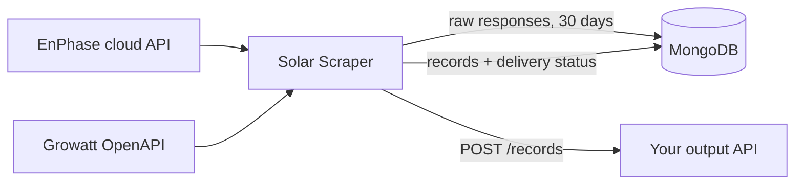

# Solar Scraper

Solar Scraper is a background service that collects power data from solar
inverters and forwards it to your own API. It supports two inverter vendors:

- **EnPhase**: micro-inverters, read through the EnPhase cloud API (OAuth2).
- **Growatt**: MIN/TLX hybrid inverters, read through the Growatt OpenAPI
  (static API token).

Each solar installation you want to collect is an **account**. The service
polls every account at its own interval, stores what it receives in MongoDB,
converts it into a simple record, and POSTs that record to the **output API**
you configure.



If the output API is down, records are kept in MongoDB and delivered later.
Nothing is lost because a delivery failed.

## Where to start

| You want to… | Read |
|---|---|
| Learn the terms used in these docs | [Concepts](operations/concepts.md) |
| Install the service on a new machine | [Installation](operations/installation.md) |
| Look up a setting | [Configuration](operations/configuration.md) |
| Add, change or remove a solar installation | [Managing accounts](operations/accounts.md) |
| Check that everything is running | [Monitoring](operations/monitoring.md) |
| Back up, upgrade, restart or scale | [Maintenance](operations/maintenance.md) |
| Fix something that stopped working | [Troubleshooting](operations/troubleshooting.md) |
| Understand or change the code | [Architecture](technical/architecture.md) |

## What gets sent to the output API

Every record is sent as a JSON body in `POST <OUTPUT_API_URL>/records`, with
`Authorization: Bearer <OUTPUT_API_TOKEN>` if a token is configured. All
timestamps are UTC.

**EnPhase**: one record per poll, for the whole installation:

```json
{
  "account_id": "office",
  "timestamp": "2026-10-14T12:15:00Z",
  "inverters": {"482301012345": 150.5, "482301012346": 148.0},
  "total_power": 298.5
}
```

`inverters` maps each micro-inverter, by serial number, to its current output
in watts, and `total_power` is their sum. An inverter that reported no power
has `null`; it is left out of `total_power`, which is itself `null` if no
inverter reported any. `timestamp` is the time of the most recent inverter
report to EnPhase.

**Growatt**: one record per inverter per poll:

```json
{
  "account_id": "my-home",
  "timestamp": "2026-10-14T12:10:00Z",
  "device_sn": "ABC1234567",
  "ac_power_watts": 2310.0,
  "pv_power_watts": 2480.0,
  "soc_percent": 87
}
```

`ac_power_watts` is the AC output, `pv_power_watts` the solar panel input,
and `soc_percent` the battery state of charge. Each is `null` when Growatt
sent no value for it. `timestamp` is the time of the poll.

Every record carries the `account_id` the account was stored under (see
[Managing accounts](operations/accounts.md)), so your API can tell
installations apart.

!!! note "Personal data"
    Records contain no names or addresses, as long as account IDs don't
    either. The EnPhase site name, which is often the owner's name, is
    deliberately not sent, stored or logged.
