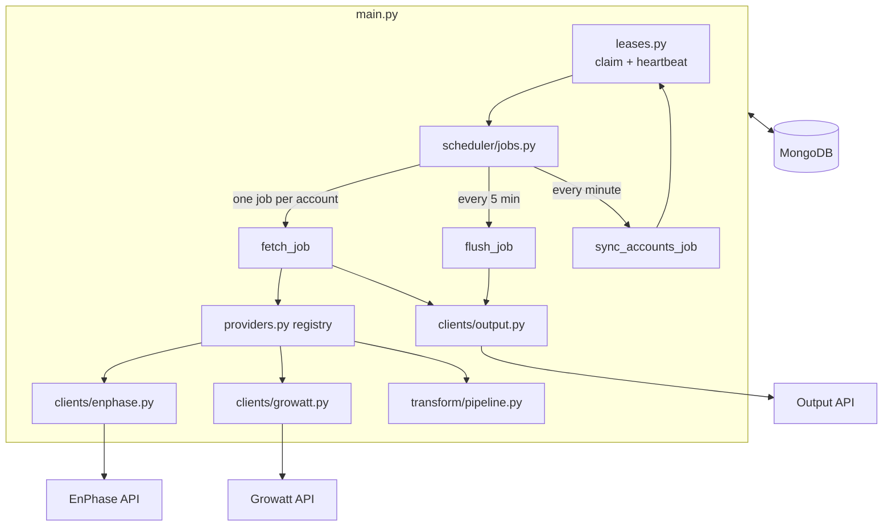

# Architecture

This page is for developers who maintain or extend the service. For running
it, see the Operations section.

## Overview

The service is a single Python 3.13 asyncio process (`main.py`). It uses
APScheduler for timing, PyMongo's async client for MongoDB, httpx for HTTP,
and the vendor SDK `growattServer` for Growatt.



## Startup

`main._main()` does, in order:

1. Load settings (`config.py`, pydantic-settings).
2. Connect to MongoDB and create indexes (`db/mongo.py`).
3. Check that the output API is reachable, and exit if not. This happens
   before any lease is claimed, so an exit holds nothing.
4. Claim leases on all free, enabled accounts (`leases.claim_leases`).
5. Register one fetch job per claimed account, the flush job and the sync
   job, and start the lease heartbeat. With no accounts the service still
   starts and waits for the sync job to find some.
6. Run until SIGTERM/SIGINT, then shut down in order: pause the scheduler,
   wait for running jobs (`SHUTDOWN_TIMEOUT_SECONDS`), cancel the rest,
   stop the heartbeat, release leases.

## One fetch cycle

`scheduler.jobs.fetch_job`, for one `(provider, account_id)`:

1. Re-read the account from MongoDB, so credential changes apply at once.
   Skip if the lease is lost, or the account is disabled or `auth_failed`.
2. Call the provider's `fetch` through the registry in `providers.py`.
3. Record health on the account (`last_success_at`, `last_fetch_at`,
   `consecutive_failures`, `consecutive_auth_failures`).
4. Store the raw responses in `raw_responses` (TTL index).
5. Transform into rows (`transform/pipeline.py`, pure functions, validated
   by the pydantic models in `transform/schemas.py`).
6. Insert each row into `processed_results` with status `posting`, POST it,
   and store the outcome.

The first run of each job resumes the rhythm of the previous process
(`last_fetch_at + interval`) when possible, otherwise it is offset by a
hash of the account ID. This keeps restarts from tripping provider rate
limits.

## Delivery and retries

`clients/output.py` POSTs to `<OUTPUT_API_URL>/records`. There are two
levels of retry:

- **Within one delivery:** up to 3 HTTP attempts with exponential backoff,
  for timeouts, 5xx and 429. Other 4xx responses are permanent and are not
  retried here.
- **Across deliveries:** `flush_job` runs every 5 minutes (with per-process
  jitter). It re-sends `failed` records with `retry_count < 5`, and reclaims
  records stuck in `posting` for more than 5 minutes (left behind by a
  crash). Up to 100 of each per run.

## Providers

| | EnPhase | Growatt |
|---|---|---|
| Auth | OAuth2, tokens refreshed inline when < 2 h remain, written back to MongoDB | Static API token |
| Calls per cycle | 1 (inverter summary), plus `/systems` once, plus token refresh ~daily | 1 per inverter, plus plant and device list once per 24 h |
| Cache | `site_cache` on the account (until re-seed) | `growatt_cache` on the account (24 h) |
| Records per cycle | 1 per installation | 1 per inverter |
| HTTP | httpx (`TimedClient`) | `growattServer` SDK in a thread (`asyncio.to_thread`) |

EnPhase auth failures (HTTP 401) increment `consecutive_auth_failures`; at
3 the account is frozen with `auth_failed=True` until re-seeded. A 401 on a
data call first triggers one forced refresh, in case another process
rotated the token.

Adding a provider means adding a credentials model (`db/models.py`), a
client, a transform function, and an entry in `providers.REGISTRY`.

## Data model

MongoDB database `solar_scraper`, models in `db/models.py`:

| Collection | Contents |
|---|---|
| `api_configs` | One document per account, `_id = "<provider>::<account_id>"`. Credentials (secret fields Fernet-encrypted, see `crypto.py`), interval, lease, provider cache, health fields. Written by `manage_keys.py` and the service. |
| `raw_responses` | Verbatim provider responses, deleted after `RAW_TTL_DAYS`. |
| `processed_results` | One document per output record: the record itself (also the POST body), status, `retry_count`, `last_error`. Delivered (`posted`) records expire `POSTED_TTL_DAYS` after `created_at` (partial TTL index `posted_ttl`); undelivered ones are kept. |

`seeded_at` is set only by `manage_keys.py`. Writes made by the service
after a provider call (token refresh, caches, auth failures) are conditional
on it being unchanged, so a cycle that started before a re-seed cannot
overwrite the new credentials.

## Leases

Each account document has `lease = {worker_id, expires_at}`. At startup an
worker claims every enabled account whose lease is empty or expired
(atomic `find_one_and_update`). A heartbeat renews held leases every
`LEASE_RENEWAL_INTERVAL` seconds to *interval × `LEASE_TTL_MULTIPLIER`*. On
a clean shutdown leases are released.

`sync_accounts_job` repeats the claim every minute and brings the fetch jobs
in line: it adds jobs for newly held accounts, reschedules changed
intervals, and removes jobs for accounts no longer held. That is what makes
account changes apply without a restart, and lets an idle worker take over
from a dead one.

## Health check

The lease heartbeat touches `/tmp/solar-scraper.alive` every
`LEASE_RENEWAL_INTERVAL` seconds. `healthcheck.py`, run by the Compose
health check, fails when that file is older than four intervals. It is
defined in `docker-compose.yml`, not the Dockerfile, because Podman builds
OCI images, which do not support `HEALTHCHECK`.

## Development

```bash
uv sync --all-extras
uv run pytest tests/
uv run python dev.py serve     # local echo server that prints received records
uv run --group docs zensical serve   # preview these docs
```

Run the tests with `uv run --all-extras`: a plain `uv run` syncs the
environment without the test extras and removes pytest.

The `flake.nix` dev shell is optional; uv alone is enough. Design history
and decisions are in `PLAN.md` and `IMPL.md`.
